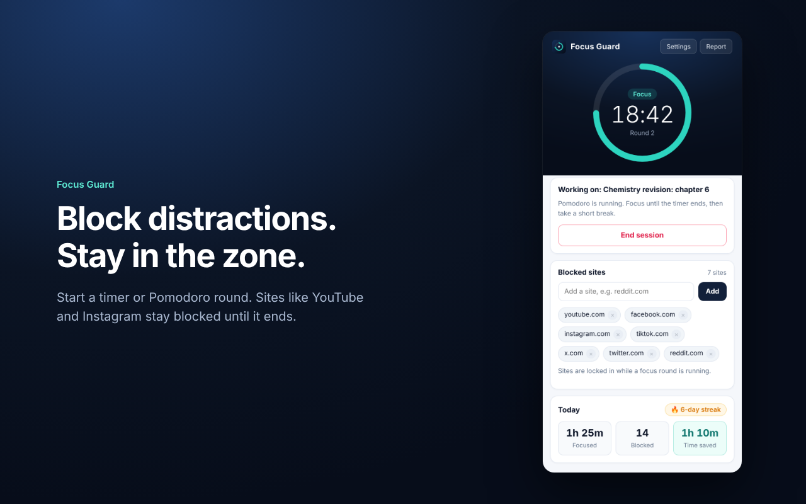
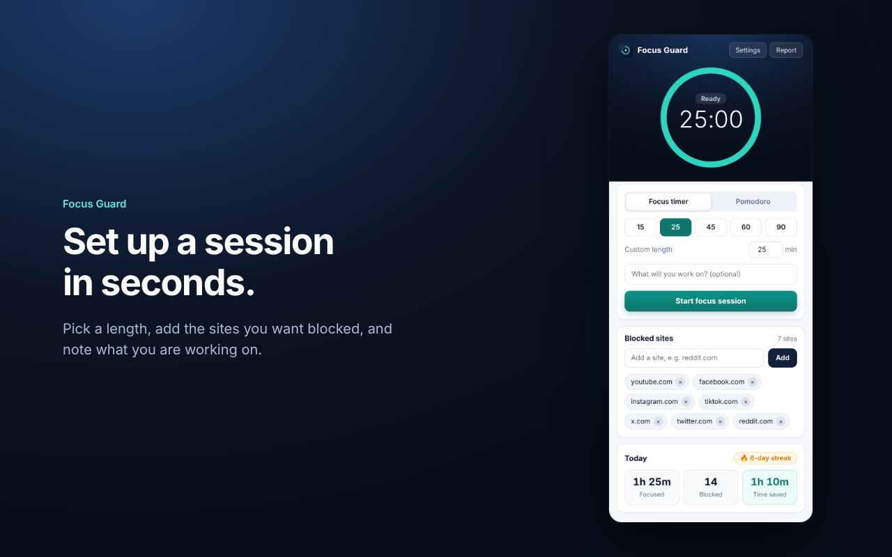
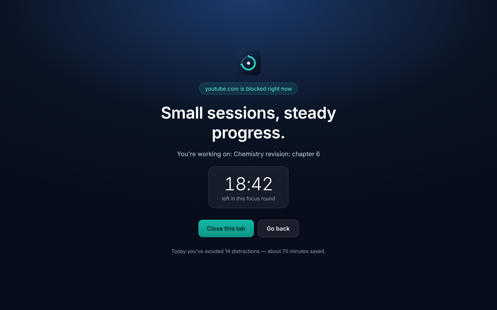
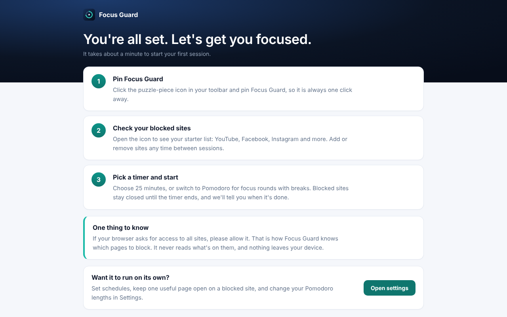

# Focus Guard: Distraction Blocker

<div align="center">

[](LICENSE)

[](https://github.com/Mahnoor-fatima249/focus-guard-/ releases)

[](https://github.com/Mahnoor-fatima249/focus-guard-)

</div>

## 🚀 Overview

Focus Guard is a privacy-focused browser extension that helps you regain control of your time by blocking distracting websites during focus sessions. No accounts, no tracking — everything stays locally on your device.

## ✨ Features

- **Website Blocking**: Block YouTube, Facebook, Instagram, TikTok, X, Reddit, and any custom sites
- **Focus Timer**: Simple timer for focused work sessions
- **Pomodoro Technique**: Built-in short and long break cycles
- **Schedules**: Automatically start focus sessions (e.g., weekdays 9am–1pm)
- **One Exception**: Keep one useful page open while blocking the rest of a site
- **Daily Goals & Streaks**: Track your focus habits and build momentum
- **Daily Reports**: See how long you focused, what was blocked, and estimated time saved
- **Privacy by Design**: All data stays on your device. No collection, no tracking, no ads.

## 📦 Installation

### From Source

1. Clone the repository:
   ```bash
   git clone https://github.com/Mahnoor-fatima249/focus-guard-.git
   ```
2. Load the extension in your browser:
   - **Chrome/Edge**: Go to `chrome://extensions/` → Enable "Developer mode" → Click "Load unpacked" → Select the extension directory
   - **Firefox**: Go to `about:addons` → Click the gear icon → "Install add-on from file..." → Select the Firefox zip

### Pre-built Packages

- `focus-guard-chrome-edge.zip` — for Chrome and Edge
- `focus-guard-firefox.zip` — for Firefox

## 📸 Screenshots

| | |
|---|---|
| **Focus Session** |  |
| **Set Timer** |  |
| **Blocked Page** |  |
| **Daily Report** |  |
| **Schedules & Settings** |  |
| **Welcome Screen** |  |

## 🏪 Store Submissions

### Publish Your Extension

Easly submit Focus Guard to the major browser stores using these developer links:

<div style="display: flex; justify-content: center; gap: 24px; flex-wrap: wrap;">

<a href="https://chrome.google.com/webstore/devconsole" target="_blank">
  
</a>

<a href="https://partner.microsoft.com/dashboard/microsoftedge" target="_blank">
  
</a>

<a href="https://addons.mozilla.org/developers" target="_blank">
  
</a>

</div>

### Extension Files

- `focus-guard-chrome-edge.zip` — Chrome and Edge
- `focus-guard-firefox.zip` — Firefox

- Build packages: `./build.sh`
- Modify `manifest.firefox.json` for custom Firefox ID
- Add feedback URL in `background.js` (line ~FEEDBACK_URL)
- Screenshots should be 1280×800 px

## 📜 Privacy

Focus Guard does not collect, transmit, sell, or share any personal data. All blocklists, schedules, settings, and focus statistics are stored locally in browser storage. The extension never reads page contents, tracks browsing history, or loads remote code.

Removing the extension deletes all stored data.

## 📄 License

This project is licensed under the MIT License. See the [LICENSE](LICENSE) file for details.

## 🙏 Acknowledgments

- Inspired by the need for focused work in a distracted world
- Built with declarativeNetRequest for efficient site blocking